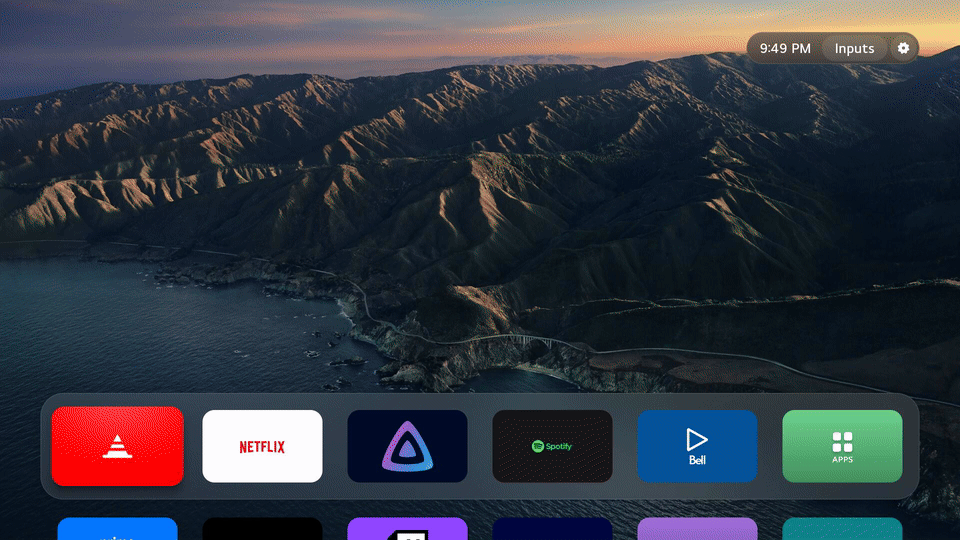

# Actually Good WebOS

WebOS's default app launcher sucks. I decided to blatantly copy Apple's tvOS home screen and make an actually good app launcher. This also includes a Control Center for the settings you change most. It's way faster than WebOS's default menu and actually looks good. 



This was entirely written using Claude Code on Opus 5.5. It works on my machine but it probably won't on yours in its current state. Feel free to fork this!

Built and tested on an LG OLED65C5PUA (webOS 10.3.1, Chromium 120 web engine), rooted, with the
[Homebrew Channel](https://www.webosbrew.org/) and its SSH server.

## Install

The scripts reach the TV as `ssh lgtv`; they don't search the network. Give the TV a fixed
address (a DHCP reservation on the router), enable SSH in the Homebrew Channel's settings, and
add an entry to `~/.ssh/config` with a key the TV accepts (the public key goes in
`/home/root/.ssh/authorized_keys` on the TV):

```
Host lgtv
    HostName 192.168.1.47
    User root
    IdentityFile ~/.ssh/id_ed25519_lgtv
    IdentitiesOnly yes
```

You also need the toolchain for the native apps (see [Home screen](#home-screen-home)). Then:

```sh
tv/install.sh                  # build and install both apps, make Home the TV's home, add the boot scripts
tv/install.sh --trim-preloads  # also stop LG preloading apps you don't use
tv/uninstall.sh                # give everything back to LG and remove both apps
tv/uninstall.sh --purge        # also delete the home screen's layout and wallpapers
```

Running `install.sh` again updates the apps; `--no-build` installs the packages already built.
`LGTV_HOST` picks another ssh host. The sections below describe each piece and how to do it by hand.

| Folder | What it is |
|---|---|
| [`control/`](control) | **Control Center**: picture, sound and power settings in a small panel over whatever is playing, opened by the remote's Settings button or from Home; native C++ like Home |
| [`home/`](home) | **Home**: a tvOS-style home screen and the TV's default Home app, native C++ with SDL2 and OpenGL ES |
| [`common/`](common) | Code both native apps share: drawing, the Luna bus, the build and packaging script |
| [`tv/`](tv) | `install.sh` and `uninstall.sh`, and the scripts they put on the TV (boot hooks, the Settings-button handler) |

## Control Center (`control/`)

A compact glass panel in the top-right corner, in the home screen's design, hanging from the
status pill, drawn over whatever is playing. It also draws Home's status pill, so the pill, Inputs
and the panel look and work the same over Home and inside apps.

- **Brightness first:** it opens with Brightness focused (LG's "OLED Pixel Brightness", the `backlight` key), so Left/Right changes it immediately.
- **Quick settings:** picture mode, eye comfort, sound mode, sound output, sleep timer, energy saving; then Screen off and More.
- **More settings:** grouped pages for Picture, Sound, OLED care & power, General and Accessibility, each with **Open in LG settings** where LG has a page for it, and **Open LG settings** for the full LG settings app. General has a Remote pointer switch to turn off the Magic Remote cursor.
- **Bluetooth:** Sound out has a **Bluetooth devices** page: paired headphones and speakers (OK connects and sends the sound there, OK again disconnects, Play forgets one) and **Search for devices** to pair new ones.
- **The pill:** over an app, the Settings button brings the pill (clock, Inputs, Control Center) down with the panel, and dims the screen behind them. Up from the panel's top row reaches the pill; Inputs there lists the HDMI inputs, as on Home.
- **Remote:** the Settings button opens and closes it; so do the Control Center and Inputs buttons of the pill. Back goes up a page, or closes it.
- **Fast:** it stays loaded and hides by moving its window off screen, so it shows about 0.1–0.25 s after the press, against about 0.4 s for the web version, and holds 60 fps (the web version ran near 48 fps with 200 ms hitches). See [`control/README.md`](control/README.md) for how it gets an overlay window from LG's SDL, and what that costs.

Settings are read and written through `luna://com.webos.settingsservice` exactly as LG's own app does. Allowed values come from `getSystemSettingDesc` on the TV, so the lists match the model and the current signal. Calls a developer app isn't allowed to make (sleep timer, screen off, Bluetooth) go through the Homebrew Channel's root `exec` service.

```sh
cd control
./build.py            # build/com.lgtvtweaks.control_<version>_all.ipk (needs the toolchain, as Home does)
tools/install.sh      # install that package on the TV
tools/shot.sh out.png DOWN ENTER   # press remote keys, then capture the screen
```

## Home screen (`home/`)

A tvOS-style home screen and the TV's default Home app: wallpaper, a glass dock of six favourites,
all other apps in a grid below, and a status pill with the clock, an **Inputs** button, the
**Control Center** and a settings button. Native C++ with SDL2 and OpenGL ES 2, linked against the TV's own libraries: a
steady 60 fps and about 50 MB of memory. It is on the app manager's keep-alive list, so the Home
button brings it back in about 50 ms.

- **Remote:** arrows move focus, OK opens. Hold OK (or press Play/Pause) on a tile to **Move** or
  **Hide** it; while moving, the arrows carry it and OK or Back drops it. Back in the grid returns
  to the dock.
- **Magic Remote:** pointing focuses, clicking opens, the wheel scrolls a row at a time.
- **Control Center** (the switches in the pill): opens the panel described above, over Home. The
  pill itself is drawn by the Control Center, which Home keeps loaded.
- **Home Settings** (the gear in the corner): wallpaper (Left/Right to switch, previewed live),
  appearance (night dims the wallpaper; automatic from 7 PM to 7 AM, always day, always night), show
  hidden apps, reset layout.
- **Inputs:** the Control Center's Inputs menu lists the HDMI inputs with the names devices give
  over CEC; OK switches.
- **Wallpapers:** Beach and Big Sur are bundled (`home/assets/wallpapers/`). To add your own, copy
  JPEGs (ideally 1920x1080) to `/var/lib/lgtv-home/wallpapers/` on the TV and pick them in Home
  Settings. The layout and settings live in `/var/lib/lgtv-home/layout.json`.

Building needs the homebrew webOS toolchain,
[buildroot-nc4](https://github.com/openlgtv/buildroot-nc4) (`arm-webos-linux-gnueabi_sdk-buildroot`,
unpacked to `~/webos-toolchain` and relocated with its `relocate-sdk.sh`), plus `cmake` and `ninja`.

```sh
cd home
./build.py            # build/com.lgtvtweaks.home_<version>_all.ipk
tools/key.sh -c /tmp/cap.png DOWN    # press remote keys over ssh and capture the screen
```

Install it, then make it the default home and keep it resident:

```sh
ssh lgtv 'cat > /tmp/home.ipk && luna-send -n 1 luna://com.webos.appInstallService/dev/install \
  "{\"id\":\"com.lgtvtweaks.home\",\"ipkUrl\":\"/tmp/home.ipk\"}" </dev/null' \
  < home/build/com.lgtvtweaks.home_*_all.ipk
ssh lgtv 'luna-send -n 1 luna://com.webos.service.applicationmanager/setDefaultApp \
  "{\"category\":\"home\",\"appId\":\"com.lgtvtweaks.home\"}" </dev/null'
```

For keep-alive, add `com.lgtvtweaks.home` to `com.webos.applicationManager.keepAliveApps` with
`com.webos.service.config/setConfigs` (the original list is in `tv/keepAlive_before.json`).

To have the TV open it at power-on, with no LG Home or last input first: with
`general/homeAutoLaunch` on, bootd launches the *system profile's* home app (not the Home
button's default), which is `com.webos.app.home` from the factory. `tv/home-profile.json`
overrides it in the profile service's override folder, and persists across reboots:

```sh
ssh lgtv 'cat > /var/webos-profile/override/lgtvtweaks_profile.json && \
  luna-send -n 1 luna://com.webos.service.systemprofile/debug/rescan "{}" </dev/null && \
  luna-send -n 1 luna://com.webos.settingsservice/setSystemSettings \
  "{\"category\":\"general\",\"settings\":{\"homeAutoLaunch\":\"on\"}}" </dev/null' < tv/home-profile.json
```

See [`home/PLAN.md`](home/PLAN.md) for how it works on the TV (the app sandbox, Luna, why not
Flutter) and what is left to do.

## TV scripts (`tv/`)

Copied to `/var/lib/webosbrew/init.d/` on the TV, where the Homebrew Channel runs them at boot. Several LG settings only last until the next reboot or wake from standby, so these re-apply them.

| Script | What it does |
|---|---|
| `settings-key` + `settingskey.js` | Adds a key handler to surface-manager (`com.webos.surfacemanager.keyFilters`) so the Settings button opens the Control Center. Loads that app hidden at boot (the TV may boot into an input, and the button must be instant there too) and again after an app switch if it was closed, and writes the foreground app's id to `/tmp/lgtv-control.foreground` for it. No system files are patched. |
| `default-home` | Opens the default Home app at power-on if the TV didn't (see [Home screen](#home-screen-home)) and keeps LG's home out of memory while something else is the default. |
| `trim-preloads` | Stops LG's preload manager keeping unused apps (browser, voice, Prime Video, Netflix, Live TV, LG Channels) in memory, at boot and after every wake. |

`settingskey.js` lives in `/var/lib/lgtv-tweaks/` on the TV.

`tv/uninstall.sh` undoes all of `tv/install.sh`: the Settings button, Home and power-on, the keep-alive list, the preloads `default-home` and `trim-preloads` turned off, the boot scripts and both apps. It edits the TV's current lists rather than restoring old copies; `tv/*_before.json` are LG's originals, for reference.

## Notes for working on the TV

- `luna-send` prints nothing over SSH unless stdin is redirected: `luna-send -n 1 <uri> '<json>' </dev/null`.
- `/usr` and `/etc` are read-only. Changes go in `/var`, through LG's config service (`com.webos.service.config/setConfigs`), or as bind mounts.
- LG's settings schema is `/etc/palm/description.json` (about 1,950 settings with types, allowed values and dimensions).
- `ls-monitor` on the TV records live Luna traffic, useful for seeing exactly what LG's own menus call.

## Credits

- [Lumen](https://github.com/ammar027/lumen-webos) (MIT): reference for the home screen and for proven Luna calls. No code copied.
- [buildroot-nc4](https://github.com/openlgtv/buildroot-nc4): the webOS cross-compiler the home screen is built with.
- Wallpapers: Big Sur is Apple's macOS Big Sur wallpaper; Beach is an aerial beach photo.

## License

[MIT](LICENSE)
